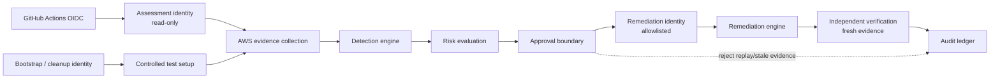

# SentinelOps

SentinelOps is a headless AWS cloud security assessment and approval-gated remediation platform. It is designed to discover and assess AWS configuration issues, calculate explainable risk, require explicit approval before remediation, and independently verify the post-change state with fresh evidence before reducing the finding to a resolved state.

## Project overview

The repository models a practical cloud security engineering workflow without relying on a browser UI. The application is intentionally kept headless: a Python backend and CLI-friendly workflow with FastAPI endpoints for local read-only inspection, a deterministic scenario engine, a risk engine, and an approval-based remediation and verification pipeline.

This project is intentionally local-first, but it also includes a controlled live AWS sandbox validation path that was explicitly authorized and executed under strict scope. The local automated tests remain deterministic and synthetic, while the live AWS evidence is a separate record of actual account-state checks performed under the approved sandbox conditions.

## Live AWS evidence and scope distinction

The live AWS validation that occurred on 2026-11-13 was for the approved sandbox demo only and was intentionally limited to the temporary public S3 bucket, the temporary public security group, and the temporary wildcard IAM role created for that exact scenario.

Actual findings observed before remediation:
- S1: `finding_detected` for public or unsafe S3 access
- S2: `finding_detected` for excessive IAM privileges
- S3: `finding_detected` for public admin ingress on 22/3389

Actual post-remediation and cleanup evidence:
- S3 public access block: `BlockPublicAcls=true`, `IgnorePublicAcls=true`, `BlockPublicPolicy=true`, `RestrictPublicBuckets=true`
- Security group `sg-080bf854cd7fbc613`: no remaining public ingress rules
- Temporary demo bucket `sentinelops-demo-public-bucket-001`: removed
- Temporary demo wildcard IAM role: removed
- Persistent project roles `sentinelops-assessment` and `sentinelops-remediation`: still present

Important distinction: the direct AWS mutation and cleanup were performed with AWS CLI / boto3 calls in the live account. The application workflow `execute_remediation` was then invoked to validate the state and consume approval/verification records, but it did not itself perform the live AWS mutation. The supporting ledger and session evidence shows that the workflow was used to record and validate the live remediation, not as the origin of the AWS-side changes.

The recorded evidence is stored in:
- [evidence/live-discovery-2026-11-13.json](evidence/live-discovery-2026-11-13.json)
- [evidence/live-discovery-2026-11-13-post-remediation.json](evidence/live-discovery-2026-11-13-post-remediation.json)

## AWS demonstration instructions

A future AWS sandbox demonstration is deliberately blocked until explicit authorization. The repository supports a controlled runbook path, but no live AWS deployment, credential configuration, or Terraform apply is part of the default workspace validation.

Before any live AWS use, the user must authorize:

- target sandbox account,
- region `eu-west-1`,
- GitHub OIDC repo/environment trust,
- cost ceiling and cleanup plan,
- explicit deployment approval.

The live AWS validation that was actually performed on 2026-11-13 was a controlled sandbox proof, not an unrestricted project deployment.

## Problem statement

Security posture assessment is only useful when the evidence is fresh, the risk is explainable, and the remediation path is explicitly controlled. SentinelOps addresses this by separating:

- read-only assessment identity,
- approval boundary,
- remediation identity,
- independent verification,
- audit ledger persistence.

The goal is to demonstrate that findings are not just detected, but also reviewed and safely remediated under a fail-closed model.

## Architecture

The implementation is centered around a local Python pipeline:

- AWS evidence collection is modeled through read-only collectors for S3, IAM, EC2, CloudTrail, and related metadata.
- Scenario rules evaluate the evidence for the supported misconfigurations.
- Risk scoring converts scenario outcomes into explainable hazard values.
- Remediation requests require a valid allowlisted action and an approval hash bound to action, target, and reason.
- The remediation workflow consumes the approval atomically and prevents replay.
- Fresh evidence from a separate session is required before a finding is marked resolved.
- Audit results and decisions are tracked in a local SQLite-backed ledger.



## Security model

SentinelOps enforces the following controls:

- Read-only assessment and separate remediation identities.
- Approval hash binding to action, target, and rationale.
- Atomic approval consumption with persistent SQLite ledger protection.
- Reused session IDs and stale evidence are rejected.
- Verification must be performed with fresh evidence before a finding is marked resolved.
- In the local project, all AWS interactions are intentionally synthetic and do not reach a real account.
- CLI and API flows remain headless and do not expose a browser UI.

## Supported scenarios

The supported deterministic scenarios are:

- Public S3 bucket exposure.
- IAM wildcard permissions.
- Public administrative ingress on SSH (22) and RDP (3389).
- Additional security and drift scenarios are included in the deterministic rule engine for testing and documentation.

## Detection workflow

1. Collect read-only evidence.
2. Normalize and fingerprint the AWS resource.
3. Evaluate the scenario rule.
4. Score the finding with explainable severity and risk logic.
5. Record evidence and finding metadata.
6. Require an approval before remediation is allowed.

## Approval-gated remediation workflow

1. Create an approval using a valid action, target, and reason.
2. Validate action allowlisting and approval hash binding.
3. Ensure the approval is not expired or already consumed.
4. Execute remediation through the restricted remediation identity.
5. Require fresh evidence from a separate assessment session.
6. Mark the finding as resolved only when verification confirms the misconfiguration is absent.

## Independent verification

The project does not trust a successful remediation API call as proof that the issue is fixed. A fresh assessment session is required; stale or reused evidence is rejected and the finding remains unresolved or inconclusive.

## IAM separation

The Terraform baseline and source validation model distinguish:

- bootstrap identity: setup and cleanup only,
- assessment identity: read-only discovery and evidence gathering,
- remediation identity: targeted action allowlist,
- GitHub OIDC deployment identity: separate trust path for future CI/CD, not used in this local validation.

## Technology stack

- Python 3.11+
- FastAPI
- Pydantic
- SQLite for the approval and session ledgers
- boto3 for assessment workflow modeling
- Terraform for security baseline review and OIDC trust policy modeling
- pytest, Ruff, mypy, Bandit, pip-audit

## Repository structure

- src/sentinelops: application logic, scenario evaluation, risk checks, identity validation, remediation, and API.
- tests/unit: deterministic local validations and regression coverage.
- infra/terraform: baseline and policy review definitions.
- docs: architecture, reviews, runbooks, and status reports.
- scripts: local synthetic demo utilities.
- .github/workflows: GitHub Actions OIDC deployment guardrails.

## Installation

```bash
python -m venv .venv
.\.venv\Scripts\python.exe -m pip install -U pip
.\.venv\Scripts\python.exe -m pip install -e .[dev]
```

## Local demo

The local demo is intentionally synthetic and does not mutate AWS resources:

```bash
cd "c:\Users\ilyes\Desktop\sentinel ops"
\.\.venv\Scripts\python.exe -m scripts.local_end_to_end_demo
```

## Testing and validation

The project is validated locally using the project virtual environment:

```bash
cd "c:\Users\ilyes\Desktop\sentinel ops"
.\.venv\Scripts\python.exe -m pytest -q
.\.venv\Scripts\ruff.exe check .
.\.venv\Scripts\mypy.exe src
.\.venv\Scripts\bandit.exe -r src -q
.\.venv\Scripts\python.exe -m pip_audit
terraform -chdir=infra/terraform init -backend=false
terraform -chdir=infra/terraform fmt -check -recursive
terraform -chdir=infra/terraform validate
```

## AWS demonstration instructions

A future AWS sandbox demonstration is deliberately blocked until explicit authorization. The repository supports a controlled runbook path, but no live AWS deployment, credential configuration, or Terraform apply is part of the current workspace validation.

Before any live AWS use, the user must authorize:

- target sandbox account,
- region `eu-west-1`,
- GitHub OIDC repo/environment trust,
- cost ceiling and cleanup plan,
- explicit deployment approval.

## Limitations

- No live AWS deployment has been executed in this workspace.
- No live AWS validation or role assumption is claimed.
- The local validation path is deterministic synthetic evidence only.
- The project remains a secure local demonstration and readiness package until a sanctioned AWS sandbox demonstration is authorized.

## Security considerations

- The allowlist and ledger model are the primary security controls.
- Approval replay is rejected at the database layer and the workflow layer.
- The code does not accept stale evidence as proof of remediation success.
- The system is intentionally conservative when evidence is incomplete or ambiguous.
- The repository avoids secret-bearing defaults and does not rely on long-lived AWS keys in CI.

## Additional project documentation

The repository includes a set of review and runbook documents in the docs directory, including IAM, Terraform, OIDC, threat modeling, and AWS sandbox planning materials. These are source-based reviews and should not be confused with live AWS validation.
