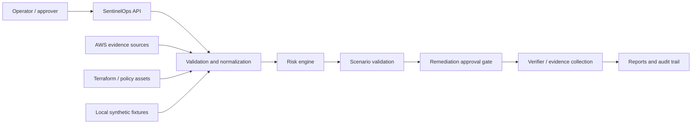

# SentinelOps architecture overview

## Purpose

SentinelOps is a local-first, approval-gated security platform for AWS risk discovery, validation, and controlled remediation. The architecture is designed to collect evidence, normalize findings, explain risk, and produce a safe execution path without encouraging destructive automation.

## High-level flow

## Core layers

1. Evidence intake
   - AWS findings, configuration checks, and local synthetic fixtures enter through a strict validation boundary.
   - Unsupported inputs are discarded or rejected early.
2. Normalization and policy
   - Records are shaped into a canonical internal schema and deduplicated by stable keys.
   - Baseline checks detect known unsafe configurations before they escalate as findings.
3. Risk scoring and correlation
   - Risk is deterministic and explainable, based on severity, confidence, exposure, and criticality.
   - Related findings are grouped by resource to surface concentrated risk.
4. Scenario verification
   - Security scenarios define expected outcomes and ensure the platform validates both negative and positive controls.
5. Approval-gated remediation
   - Remediation proposals require allowlisting and approval hashes before execution is considered valid.
6. Evidence and reporting
   - Reports are sanitized and traceable to a report ID without leaking credentials or raw secrets.

## Trust boundaries

- GitHub repository and local developer workstation are treated as non-production execution environments.
- AWS connectivity remains intentionally deferred until explicit approval.
- API endpoints are read-only by default and require authorization for write pathways.
- CI execution uses local validation and OIDC-first principles rather than static AWS credentials.

## Security posture

- No live AWS apply or remediation is authorized in the current phase.
- Synthetic fixtures replace live AWS data during validation.
- Remediation approval requires explicit allowlisting and hash-based validation.
- Evidence is sanitized before it is used in reports or project artifacts.

## Release readiness note

This architecture supports a demonstration package without exposing sensitive AWS identifiers, secret material, or active deployment state. The release package focuses on the local validation story, risk model, approval controls, and documented cleanup boundaries.
