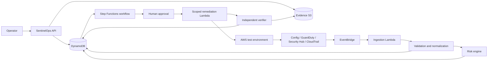

# Phase 1 architecture definition

## Context diagram

## Logical layers

1. AWS test environment
2. Collection and routing
3. Validation and normalization
4. Correlation and risk assessment
5. Workflow approval and remediation
6. Evidence and reporting

## Trust boundaries

- GitHub Actions -> AWS via OIDC (later implementation)
- AWS sources -> EventBridge
- EventBridge -> ingestion Lambda
- Lambda -> DynamoDB/S3
- Operator -> API/site-local access only
- Workflow approval -> remediation execution
- Remediation role -> target resources

## Phase 1 design constraints

- Keep the API localhost-bound until authorization is implemented.
- Use local fixture-driven validation before any AWS integration tests.
- Enforce event schema validation before any downstream processing.
- Maintain approval enforcement as a server-side workflow requirement.

## Data flow summary

- Synthetic or AWS-originated events arrive as untrusted payloads.
- Payloads are validated against the canonical schema.
- Findings are deduplicated and normalized using a versioned internal model.
- The risk engine calculates a deterministic score using explainable factors.
- Approved remediations execute against allowlisted target types only.
- A separate verifier re-reads the actual resource state before resolution.
