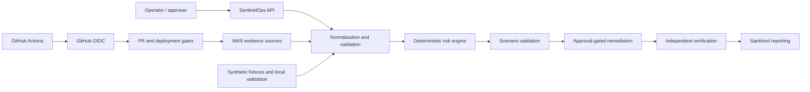
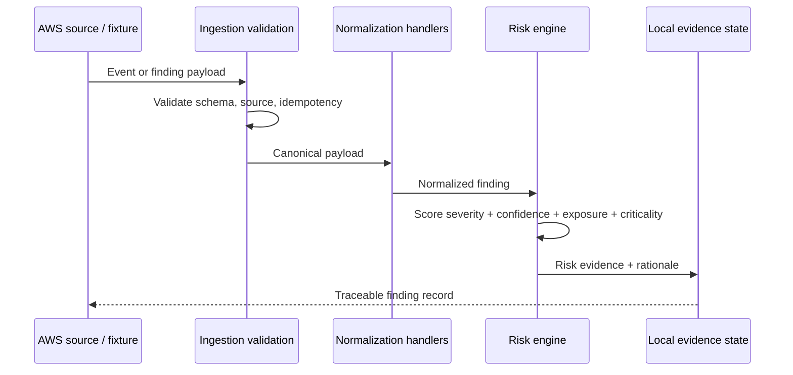
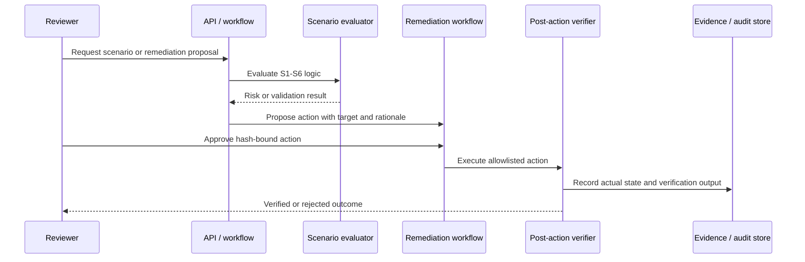

# SentinelOps Phase 12 architecture and sequence diagrams

## System context

## Ingestion and scoring flow

## Scenario validation and approval flow

## Actual implementation mapping

This release package reflects the current implementation in the repository:

- Validation and source gating: `src/sentinelops/validation/integrations.py`
- Canonical normalization: `src/sentinelops/normalization/handlers.py`
- Risk scoring and correlation: `src/sentinelops/risk.py`
- Scenario suite: `src/sentinelops/scenarios.py`
- Secure approval workflow: `src/sentinelops/remediation.py`
- Read-only API and sanitized reporting: `src/sentinelops/api/app.py` and `src/sentinelops/reporting/reporting.py`
- CI/CD hardening workflow: `.github/workflows/phase0-placeholder.yml` and `.github/workflows/deploy-oidc.yml`

These diagrams intentionally represent the implemented architecture: local-first validation, read-only by default, deterministic scoring, approval-gated remediations, and zero static AWS credentials in automation.
